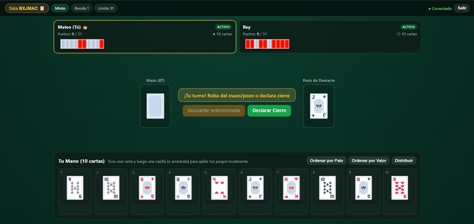
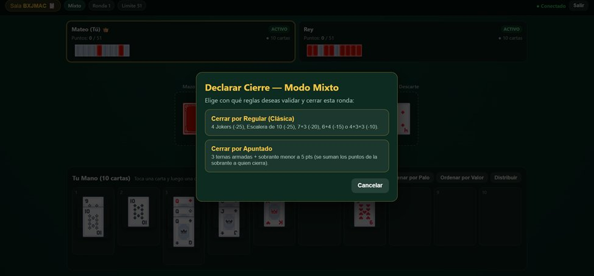
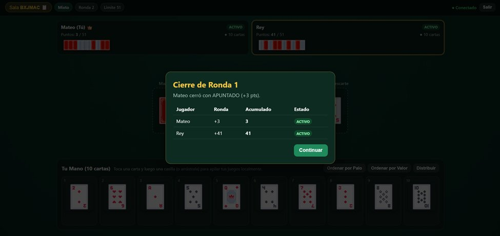
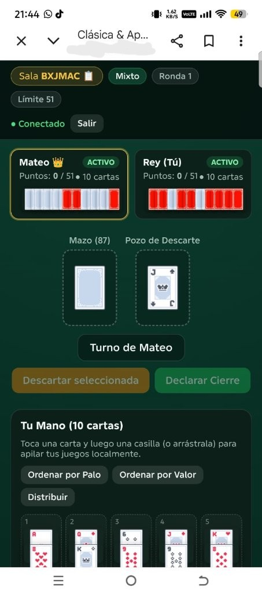
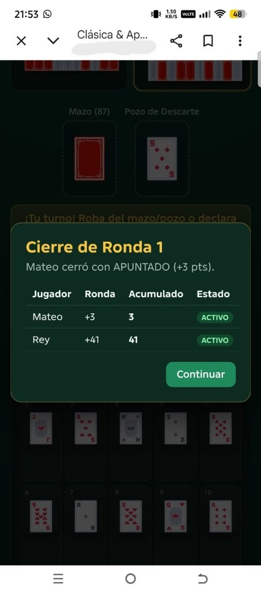

# Clásica & Apuntado 101 — Juego de Cartas Multijugador

Aplicación web multijugador en tiempo real para un juego de cartas modular construido como **Monolito Modular** en Java 21 con servidor embebido **Javalin** (HTTP REST + WebSockets), persistencia local ACID en **SQLite** y cliente web *responsive* (PC y móvil) en HTML5, CSS3 y Vanilla JavaScript.

---

## 1. Descripción del proyecto

El sistema permite crear y unirse a salas privadas mediante códigos alfanuméricos de **6 dígitos** para jugar partidas de **2 a 16 jugadores**, escalando dinámicamente entre **1 y 4 barajas** (máximo 4 jugadores por baraja, con reverso rojo en barajas impares y azul en barajas pares) y soporte opcional de **Jokers** (2 por baraja).

### Modalidades soportadas (`app.core.GameMode`)

1. **Clásica (`CLASSIC` — Regular):** el cierre se valida contra una cadena ordenada de evaluadores en `app.rules.classic` que otorgan bonificaciones negativas al ganador de la ronda (se restan de su puntaje acumulado):

   | Evaluador | Código de cierre | Combinación requerida (10 cartas) | Bonificación |
   | :--- | :--- | :--- | :---: |
   | `FourJokersEvaluator` | `FOUR_JOKERS` | 4 Jokers en mano | **-25 pts** |
   | `FullStraightEvaluator` | `FULL_STRAIGHT` | Escalera completa de 10 cartas | **-25 pts** |
   | `SevenThreeEvaluator` | `SEVEN_THREE` | Escalera de 7 cartas + terna de 3 cartas | **-20 pts** |
   | `FourSixEvaluator` | `FOUR_SIX` | Escalera de 6 cartas + cuarta de 4 cartas | **-15 pts** |
   | `FourThreeThreeEvaluator` | `FOUR_THREE_THREE` | Cuarta de 4 cartas + dos ternas de 3 cartas | **-10 pts** |

2. **Apuntado (`APUNTADO`):** valida exclusivamente un cierre `3-3-3` (tres ternas de 3 cartas) + **1 carta sobrante** cuyo valor sea estrictamente menor al límite configurable `apuntadoCloseLimit` (rango `2` a `26`, por defecto `5`, es decir sobrante de 1 a 4 puntos). El valor de esa carta sobrante se suma al puntaje de quien declara el cierre.
3. **Mixta (`MIXED`):** combina ambas modalidades en la misma sala; al declarar cierre, el jugador elige si desea validar la ronda bajo reglas de **Regular (`CLASSIC`)** o **Apuntado (`APUNTADO`)**.

### Reglas y políticas configurables (`app.core.GameConfig`)

- **Límites de eliminación (`EliminationLimit`):** `51`, `101` (por defecto), `151`, `201` o `251` puntos acumulados.
- **Políticas de valor de cartas (`CardValuePolicy`):**
  - `STANDARD`: A=1, 2–10 nominal, J/Q/K=10, Joker=25 *(por defecto)*.
  - `ACE_TEN`: A=10, 2–10 nominal, J/Q/K=10, Joker=25.
  - `ACE_ELEVEN`: A=11, 2–10 nominal, J/Q/K=10, Joker=25.
  - `FACE_SEQUENTIAL`: A=1, 2–10 nominal, J=11, Q=12, K=13, Joker=25.
- **Políticas de escaleras (`CyclePolicy`):**
  - `CYCLIC`: permite vuelta completa a través del As (`Q-K-A`, `K-A-2`, `Q-K-A-2`) *(por defecto)*.
  - `LINEAR`: permite As bajo (`A-2-3`) o alto (`Q-K-A`), sin vuelta (`K-A-2` inválido).
  - `LINEAR_ACE_LOW`: estrictamente lineal (`A-2-...-K`).
- **Barajas y jugadores:** entre `2` y `16` jugadores y entre `1` y `4` barajas, validando mínimo `⌈jugadores / 4⌉` barajas. Reciclado automático del pozo de descarte al agotarse el mazo, conservando visible la última carta descartada.

---

## 2. Arquitectura

El proyecto implementa un **Monolito Modular** con composición raíz en `app.Main` y cuatro reglas de gobernanza arquitectónica verificadas de forma automatizada en cada compilación.

### Principios y patrones clave

- **Composition Root (`app.Main`):** instancia `SqliteDatabaseManager` (inicializando el esquema), `SqlitePlayerRepository`, `PlayerSessionManager`, `SqliteScoreRepository`, `RuleEngine` (con `ClassicRulesStrategy` y `ApuntadoRulesStrategy`), `GameOrchestrator` y `GameServer`.
- **Topología Mediador (RG-03):** `app.gameplay.orchestrator.GameOrchestrator` (implementando `IGameController`) coordina los módulos colaterales `app.deck`, `app.rules`, `app.scoring` y `app.player`. Ningún módulo colateral depende de otro módulo colateral; las entidades compartidas (`Card`, `Suit`, `Rank`, `CardBack`, `GameConfig`, `GameMode`, políticas y `SqliteDatabaseManager`) residen en `app.core`.
- **Patrón Estrategia desacoplado (RG-02):** `app.rules.classic` (`ClassicRulesStrategy`) y `app.rules.apuntado` (`ApuntadoRulesStrategy`) implementan `IGameRulesStrategy` y son completamente independientes entre sí. `RuleEngine` despacha a la estrategia correspondiente (incluyendo la resolución de cierre en modo `MIXED`). Tampoco existen dependencias circulares entre los paquetes de primer nivel.
- **Aislamiento de capas (RG-01):** los paquetes `app.ui`, `app.gameplay.controller` y la capa de transporte `app.infrastructure.web` interactúan únicamente con `IGameController` y tipos de `app.core`, sin acceder directamente a repositorios ni a servicios de módulos colaterales. Asimismo, `GameOrchestrator` no depende de adaptadores concretos de `..infrastructure..`.
- **Gobernanza automatizada y Complejidad Ciclomática `<= 10` (RG-04):**
  - `tests/architecture/ArchitectureFitnessTest.java` valida **RG-01**, **RG-02** y **RG-03** con **ArchUnit**, y **RG-04** (`CC <= 10` en `app.rules..` y `app.scoring.calculator..`) con **JavaParser**.
  - `tests/unit/architecture/TransportIsolationTest.java` refuerza el aislamiento de `app.infrastructure` y `app.gameplay.orchestrator`, además de verificar `CC <= 10` en `app/gameplay/orchestrator` y `app/infrastructure/web`.
  - **Checkstyle** (`checkstyle.xml`) exige `CyclomaticComplexity <= 10` en `app/rules/**/*.java` y `app/scoring/calculator/**/*.java` durante la fase `verify` de Maven (`failOnViolation=true`).

### Estructura real del repositorio

```text
codigo-1/
├── pom.xml                                        # Configuración Maven, dependencias, Surefire y Checkstyle
├── checkstyle.xml                                 # Regla Checkstyle: CyclomaticComplexity <= 10
├── gemini.md                                      # Plan de desarrollo y gobernanza arquitectónica
├── docs/
│   └── screenshots/                               # Capturas de la interfaz web (PC y móvil)
├── src/
│   └── main/
│       ├── java/app/
│       │   ├── Main.java                          # Composition Root y arranque del servidor Javalin
│       │   ├── core/                              # Entidades compartidas, enums y políticas (Card, GameConfig, GameMode, ...)
│       │   │   └── infrastructure/
│       │   │       └── SqliteDatabaseManager.java # Conexiones SQLite, schema.sql y migraciones automáticas
│       │   ├── deck/service/                      # IDeckService, DeckManager (1-4 barajas, Jokers, reciclado)
│       │   ├── rules/
│       │   │   ├── engine/                        # IRuleEngine, RuleEngine, IGameRulesStrategy, HandPartitioner, MeldValidator
│       │   │   ├── classic/                       # ClassicRulesStrategy y 5 evaluadores de cierre (RG-02, RG-04)
│       │   │   └── apuntado/                      # ApuntadoRulesStrategy (3-3-3 + sobrante < límite)
│       │   ├── scoring/
│       │   │   ├── calculator/                    # PenaltyCalculator (CC <= 10)
│       │   │   ├── service/                       # IScoreService, IScoreRepository, ScoreManager, modelos de ronda
│       │   │   └── infrastructure/                # SqliteScoreRepository (transacciones ACID)
│       │   ├── player/
│       │   │   ├── service/                       # IPlayerService, IPlayerRepository, PlayerSessionManager
│       │   │   └── infrastructure/                # SqlitePlayerRepository
│       │   ├── gameplay/
│       │   │   ├── orchestrator/                  # IGameController, GameOrchestrator (Mediador), vistas filtradas
│       │   │   └── controller/                    # GameController
│       │   ├── infrastructure/web/                # GameServer, LobbyHttpHandler, GameWebSocketHandler y DTOs
│       │   └── ui/                                # GameView
│       └── resources/
│           ├── schema.sql                         # DDL SQLite (Jugador, Partida, ParticipantePartida, Ronda, PuntajeRonda)
│           └── static/
│               ├── index.html                     # Lobby, sala de espera, mesa de juego y modales
│               ├── css/styles.css                 # Layout responsive (Grid/Flexbox) y 10 casillas apilables
│               ├── js/
│               │   ├── app.js                     # Cliente HTTP/WS, reconexión vía localStorage y renderizado
│               │   └── board.js                   # Tablero local de 10 casillas (clic/toque y drag & drop)
│               └── assets/cards/                  # Imágenes de cartas (cardback, clubs, diamonds, hearts, jokers, spades)
└── tests/
    ├── architecture/
    │   └── ArchitectureFitnessTest.java           # Fitness functions RG-01 a RG-04 (ArchUnit + JavaParser)
    └── unit/
        ├── architecture/                          # TransportIsolationTest
        ├── core/                                  # GameConfigAndPoliciesTest
        ├── deck/                                  # DeckManagerTest
        ├── rules/                                 # HandPartitionerTest, ClassicRulesStrategyTest, ApuntadoRulesStrategyTest, MixedModeRulesTest
        ├── scoring/                               # ScoreManagerAndPenaltyTest, SqliteScoreTransactionTest
        ├── player/                                # PlayerSessionManagerSqliteTest
        ├── gameplay/                              # GameOrchestratorIntegrationTest, MultiplayerMatchEndToEndTest
        └── infrastructure/                        # WebServerAndWebSocketTest, WebSocketGameplayEndToEndTest
```

---

## 3. Requisitos

- **Java JDK 21** (`<maven.compiler.release>21</maven.compiler.release>` en `pom.xml`).
- **Apache Maven 3.8+** (compatible con los plugins declarados en `pom.xml`).
- **Navegador web moderno** (escritorio o móvil) con soporte para WebSockets y `localStorage`.

---

## 4. Instalación

1. Clona o abre el repositorio y sitúate en la carpeta raíz del proyecto (`codigo-1`):

   ```bash
   cd codigo-1
   ```

2. Verifica que cuentas con Java 21 y Maven instalados correctamente:

   ```bash
   java -version
   mvn -version
   ```

3. Descarga las dependencias y compila el proyecto:

   ```bash
   mvn dependency:resolve
   mvn clean compile
   ```

### Base de datos SQLite embebida

No es necesario instalar ni configurar ningún motor de base de datos externo. Al iniciar `app.Main`, `SqliteDatabaseManager` crea automáticamente el archivo local `juego-cartas.db` (configurable mediante `-Dapp.db=jdbc:sqlite:...` o la variable de entorno `DB_URL`), activa `PRAGMA foreign_keys = ON` y ejecuta de forma transaccional `src/main/resources/schema.sql`, creando las tablas:

- `Jugador`
- `Partida`
- `ParticipantePartida`
- `Ronda`
- `PuntajeRonda`

Además, incluye migraciones automáticas para bases existentes (soporte de modalidad `MIXED`, hasta 16 jugadores, columna `limite_cierre_apuntado` y estado `ABANDONADO`).

---

## 5. Ejecución

### Ejecutar la suite completa de pruebas, arquitectura y Checkstyle

```bash
mvn clean verify
```

Este comando compila el proyecto, ejecuta las **87 pruebas automatizadas** distribuidas en **15 clases** (unitarias, integración, E2E multijugador/WebSockets, transacciones ACID SQLite y pruebas de arquitectura con ArchUnit/JavaParser) y corre la verificación de **Checkstyle** (`CC <= 10`).

### Arrancar el servidor web y WebSocket

```bash
mvn compile exec:java "-Dexec.mainClass=app.Main"
```

> El puerto por defecto es `7070` y puede sobrescribirse con `-Dapp.port=8080` o con la variable de entorno `PORT`.

### Acceso a la aplicación

- **En el mismo equipo:** abre `http://localhost:7070` en tu navegador.
- **Desde otros dispositivos en la misma red local (Wi-Fi / Ethernet):** el servidor escucha en `0.0.0.0` e imprime automáticamente en consola las direcciones LAN detectadas. Abre `http://<IP_LOCAL>:7070` desde un celular u otro PC en la misma red.

---

## 6. Tecnologías

Todas las versiones listadas provienen directamente de `pom.xml`:

| Categoría | Tecnología | Versión | Uso en el proyecto |
| :--- | :--- | :---: | :--- |
| Lenguaje | Java (JDK) | `21` | Núcleo de dominio, reglas, orquestador y servidor |
| Build & Gestión | Apache Maven | `3.8+` | Gestión de dependencias, empaquetado y verificación (`Surefire 3.2.5`, `Checkstyle Plugin 3.3.1`) |
| Servidor Web / WS | Javalin (`io.javalin:javalin`) | `6.3.0` | API HTTP REST, canal WebSocket `/ws/{roomCode}` y servicio de archivos estáticos |
| Serialización | Jackson Databind (`jackson-databind`) | `2.17.2` | Serialización/deserialización JSON en REST y WebSockets |
| Persistencia | SQLite JDBC (`org.xerial:sqlite-jdbc`) | `3.46.1.0` | Base de datos embebida con transacciones ACID (`BEGIN`/`COMMIT`/`ROLLBACK`) |
| Logging | SLF4J Simple (`slf4j-simple`) | `2.0.16` | Registro de eventos del servidor y direcciones LAN |
| Frontend | HTML5, CSS3 (Grid/Flexbox), Vanilla JS | — | Interfaz *responsive* PC/móvil, tablero local de 10 casillas y reconexión vía `localStorage` |
| Pruebas Unitarias / E2E | JUnit Jupiter (`junit-jupiter`) | `5.10.2` | Suite unitaria, integración, E2E multijugador y WebSockets |
| Fitness Functions | ArchUnit (`archunit-junit5`) | `1.3.0` | Verificación de RG-01, RG-02, RG-03 y aislamiento de transporte |
| Análisis AST | JavaParser (`javaparser-core`) | `3.25.10` | Cálculo de complejidad ciclomática (`CC <= 10`) en pruebas de arquitectura |
| Análisis Estático | Checkstyle (`checkstyle`) | `10.12.7` | Validación obligatoria de `CC <= 10` en `app/rules` y `app/scoring/calculator` |

---

## 7. Ejemplos de uso

### Flujo de una partida multijugador en la interfaz web

1. **Crear sala (Anfitrión):** en `http://localhost:7070`, completa tu nombre en el panel **Crear Nueva Sala**, selecciona modalidad (`Clásica (Regular)`, `Apuntado a 101` o `Mixto`), límite de eliminación (`51`–`251`), máximo de jugadores (`2`–`16`), barajas (`1`–`4`), límite de cierre en Apuntado (si aplica), política de valor de cartas, política de escaleras y si deseas incluir Jokers. Haz clic en **Crear Sala**.
2. **Compartir el código de 6 dígitos:** copia el código alfanumérico mostrado en la sala de espera (botón superior o texto resaltado) y compártelo con los demás jugadores.
3. **Unir más jugadores:** abre una segunda ventana (o ventana de incógnito, o un celular en la misma red Wi-Fi vía `http://<IP_LOCAL>:7070`), ingresa un nombre y el código de 6 dígitos en **Unirse a una Sala**. Al escribir los 6 caracteres, el cliente consulta automáticamente la vista previa de la sala (`GET /api/rooms/{roomCode}`).
4. **Iniciar partida:** cuando haya al menos 2 jugadores en la sala de espera, el anfitrión pulsa **Iniciar Partida** (`START_GAME`). Cada jugador recibe 10 cartas visibles solo para sí mismo; de los oponentes únicamente se muestran la cantidad de cartas y el color de reverso (rojo/azul).
5. **Organizar la mano localmente:** usa el tablero inferior de **10 casillas apilables** (`board.js`) para agrupar escaleras y ternas sin afectar al servidor:
   - Toca/haz clic en una carta y luego en una casilla destino, o arrastra y suelta (*drag & drop*) cartas entre casillas.
   - Usa los botones rápidos **Ordenar por Palo**, **Ordenar por Valor** o **Distribuir**.
6. **Jugar un turno:**
   - **Fase de robo (`MUST_DRAW`):** roba una carta haciendo clic en el **Mazo** (`DRAW_DECK`) o toma la carta superior visible del **Pozo de Descarte** (`DRAW_DISCARD`).
   - **Fase de descarte (`MUST_DISCARD`):** selecciona una carta y pulsa **Descartar seleccionada** (o arrástrala directamente al pozo) para enviar `DISCARD`. No se permite descartar en el mismo turno la carta recién tomada del pozo.
7. **Declarar cierre:** pulsa **Declarar Cierre** en tu turno (con 10 cartas en `MUST_DRAW`, o seleccionando la carta de descarte final cuando tienes 11 cartas en `MUST_DISCARD`).
   - Si la sala está en modalidad **Mixta (`MIXED`)**, se abrirá el modal **Declarar Cierre — Modo Mixto** para elegir entre **Cerrar por Regular (Clásica)** (`CLASSIC`) o **Cerrar por Apuntado** (`APUNTADO`).
   - Al validarse el cierre, se muestra el modal **Resumen de Ronda** con puntos de la ronda, acumulados y jugadores eliminados o ganador final.
8. **Reconexión tras caída o recarga (`F5`):** la sesión se guarda automáticamente en `localStorage` bajo la clave `juego_cartas_session_v1` (`roomCode`, `matchId`, `playerId`, `playerName`, `sessionToken` y `host`).
   - Ante una desconexión temporal del WebSocket, el cliente intenta reconectarse automáticamente cada ~2.2 s enviando `RECONNECT`.
   - Si recargas la página (`F5`), en el lobby aparecerá el banner **Sesión activa detectada** con el botón **Reconectar** para volver inmediatamente a tu asiento y recuperar tu mano exacta.

### Referencia rápida de API HTTP REST (`LobbyHttpHandler`)

| Método | Ruta | Descripción |
| :---: | :--- | :--- |
| `GET` | `/api/health` | Verificación de estado (`{"status": "UP"}`) |
| `GET` | `/api/config/options` | Modalidades, políticas, rangos permitidos y configuración por defecto |
| `POST` | `/api/rooms` | Crea una sala y devuelve un `SessionTicket` (`201 Created`) |
| `GET` | `/api/rooms/{roomCode}` | Consulta resumen de una sala (`RoomOverview`) |
| `POST` | `/api/rooms/{roomCode}/join` | Une un jugador a la sala y devuelve su `SessionTicket` |
| `POST` | `/api/rooms/{roomCode}/reconnect` | Valida `sessionToken` o `playerId` y recupera el `SessionTicket` |
| `POST` | `/api/rooms/{roomCode}/leave` | Registra abandono definitivo del jugador en la sala |
| `PUT` | `/api/rooms/{roomCode}/config` | Permite al anfitrión actualizar `GameConfig` antes de iniciar |

Ejemplo de creación de sala (`POST /api/rooms`):

```json
{
  "hostName": "Mateo",
  "gameMode": "MIXED",
  "maxPlayers": 4,
  "deckCount": 2,
  "includeJokers": true,
  "cardValuePolicy": "STANDARD",
  "cyclePolicy": "CYCLIC",
  "eliminationLimit": 101,
  "apuntadoCloseLimit": 5
}
```

### Referencia rápida de WebSocket (`/ws/{roomCode}` en `GameWebSocketHandler`)

- **Eventos entrantes (cliente → servidor):**
  - `JOIN` — vincula o une un jugador a la sala (`playerId` + `sessionToken`, o `playerName`).
  - `RECONNECT` — restablece la sesión activa con `playerId` y `sessionToken`.
  - `START_GAME` — inicia la partida (solo anfitrión, mínimo 2 jugadores).
  - `DRAW_DECK` — roba la carta superior del mazo.
  - `DRAW_DISCARD` — roba la carta superior del pozo de descarte.
  - `DISCARD` — descarta `cardId` al pozo.
  - `DECLARE_CLOSE` — declara cierre (con `cardId` opcional si se está en fase `MUST_DISCARD` y `closeMode` en modo `MIXED`, aceptando `"CLASSIC"` / `"REGULAR"` o `"APUNTADO"`).
  - `LEAVE_ROOM` — abandona definitivamente la sala/partida.
  - `SYNC_STATE` — solicita reenvío puntual de `GAME_STATE`.

- **Eventos salientes (servidor → cliente):** `JOINED`, `RECONNECTED`, `GAME_STATE` (filtrado por destinatario: `viewerHand` solo contiene las cartas propias y `players` expone únicamente `cardCount` y `cardBacks`), `ROUND_CLOSED`, `LEFT_ROOM`, `PLAYER_LEFT` y `ERROR`.

Ejemplo de cierre en modo `MIXED` por WebSocket:

```json
{
  "type": "DECLARE_CLOSE",
  "playerId": "a1b2c3d4-...",
  "cardId": "D1-HEARTS-TEN",
  "closeMode": "APUNTADO"
}
```

Ejemplo abreviado del evento `GAME_STATE` recibido por cada jugador:

```json
{
  "type": "GAME_STATE",
  "payload": {
    "roomCode": "A7K9P2",
    "matchStatus": "EN_CURSO",
    "roundNumber": 1,
    "currentTurnPlayerId": "a1b2c3d4-...",
    "turnPhase": "MUST_DRAW",
    "remainingDeckSize": 87,
    "topDeckBack": "RED",
    "topDiscardCard": { "id": "D1-SPADES-SEVEN", "suit": "SPADES", "rank": "SEVEN", "back": "RED", "deckNumber": 1 },
    "viewerPlayerId": "a1b2c3d4-...",
    "viewerHand": [
      { "id": "D1-HEARTS-ACE", "suit": "HEARTS", "rank": "ACE", "back": "RED", "deckNumber": 1 }
    ],
    "players": [
      { "playerId": "e5f6g7h8-...", "name": "Sofía", "accumulatedScore": 0, "status": "ACTIVO", "connected": true, "cardCount": 10, "cardBacks": ["RED", "BLUE"] }
    ]
  },
  "error": null
}
```

---

## 8. Capturas

### Versión de escritorio (PC)

#### Lobby — Creación y unión a sala

*Pantalla inicial con el formulario de creación de sala (modalidad, límite de eliminación, jugadores, barajas, políticas de valor/escaleras y Jokers) y el panel para unirse mediante código de 6 dígitos.*

#### Mesa de juego — Tablero de 10 casillas apilables

*Mesa activa en modo Mixto mostrando barra superior con código y estado WebSocket, vista de oponentes con reversos rojo/azul, mazo, pozo de descarte y tablero inferior de 10 casillas.*

#### Modal de cierre — Modalidad Mixta (`MIXED`)

*Diálogo de elección al declarar cierre en una sala Mixta (**Cerrar por Regular (Clásica)** vs. **Cerrar por Apuntado**), con cartas apiladas localmente en las casillas del tablero.*

#### Marcador y liquidación de ronda

*Modal **Cierre de Ronda** con el tipo de cierre validado, los puntos sumados en la ronda, el puntaje acumulado y el estado resultante de cada jugador.*

### Versión móvil (Diseño Responsive en red local LAN)

| Mesa de juego con cartas apiladas (Móvil) | Liquidación de ronda (Móvil) |
| :---: | :---: |
|  |  |
| *Acceso LAN desde celular (`xxx.xxx.x.x:7070`), vista adaptada y apilado táctil de cartas en casillas.* | *Modal de cierre de ronda y cuadrícula móvil de 10 casillas apilables.* |

---

## 9. Integración CI/CD

Actualmente el repositorio **no contiene archivos de pipeline CI/CD configurados** (no existen `.github/workflows/` ni `.gitlab-ci.yml`).

No obstante, toda la validación automatizada está centralizada en un único comando reproducible con Maven:

```bash
mvn clean verify
```

### Etapas verificadas por `mvn clean verify`

1. **Compilación estricta con JDK 21** (`maven.compiler.release=21`).
2. **Pruebas unitarias e integración (JUnit 5 / Surefire):**
   - Dominio, políticas y mazo (`GameConfigAndPoliciesTest`, `DeckManagerTest`).
   - Motor de reglas y estrategias (`HandPartitionerTest`, `ClassicRulesStrategyTest`, `ApuntadoRulesStrategyTest`, `MixedModeRulesTest`).
   - Cálculo de puntaje y persistencia SQLite ACID (`ScoreManagerAndPenaltyTest`, `SqliteScoreTransactionTest`, `PlayerSessionManagerSqliteTest`).
   - Orquestación y flujos E2E multijugador y WebSockets (`GameOrchestratorIntegrationTest`, `MultiplayerMatchEndToEndTest`, `WebServerAndWebSocketTest`, `WebSocketGameplayEndToEndTest`).
3. **Fitness Functions de arquitectura:**
   - `ArchitectureFitnessTest` (ArchUnit para **RG-01**, **RG-02**, **RG-03** + JavaParser para **RG-04**).
   - `TransportIsolationTest` (aislamiento de `app.infrastructure` y `app.gameplay.orchestrator`, más `CC <= 10`).
4. **Control de complejidad ciclomática con Checkstyle (`checkstyle:check` en fase `verify`):** falla el build ante cualquier método con `CC > 10` en `app/rules/**/*.java` o `app/scoring/calculator/**/*.java`.

### Ejemplo listo para GitHub Actions (`.github/workflows/ci.yml`)

```yaml
name: CI — Verificación y Gobernanza Arquitectónica

on:
  push:
    branches: [ main, develop ]
  pull_request:
    branches: [ main, develop ]

jobs:
  verify:
    runs-on: ubuntu-latest
    steps:
      - name: Checkout del repositorio
        uses: actions/checkout@v4

      - name: Configurar JDK 21
        uses: actions/setup-java@v4
        with:
          distribution: temurin
          java-version: "21"
          cache: maven

      - name: Ejecutar pruebas, ArchUnit y Checkstyle
        run: mvn -B clean verify
```

*(Para GitLab CI, basta con definir una imagen `maven:3.9-eclipse-temurin-21` y ejecutar `mvn -B clean verify` en el stage `test`.)*
